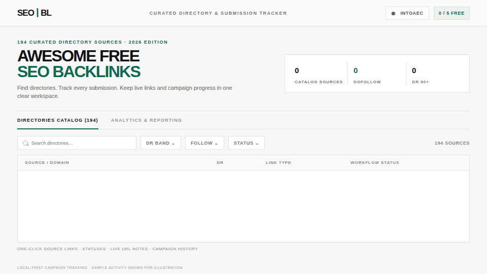

<h1 align="center">SEO Backlinks Tracker</h1>

<p align="center"><strong>Find directories. Track outreach. Keep live backlinks accountable.</strong><br>A clean, local-first workspace for organizing off-page SEO submissions—without losing progress in spreadsheets.</p>

<p align="center">
  <a href="https://github.com/ismailgito/SEO-Backlinks-Tracker"></a>
  <a href="https://github.com/ismailgito/SEO-Backlinks-Tracker"></a>
  <a href="data/backlinks.json"></a>
  <a href="https://github.com/ismailgito/SEO-Backlinks-Tracker/commits/main"></a>
</p>

<p align="center">
  
</p>

<p align="center"><sub>Illustrative product tour. The animation uses sample campaign activity; it is not live account data.</sub></p>

## At a glance

The app combines a curated directory catalog with a practical submission workflow. Search and filter potential sources, record outreach progress, save live-link details, and review campaign activity in one dashboard.

| Bundled catalog | Count |
| --- | ---: |
| Directory records | **194** |
| Labeled dofollow | **95** |
| Labeled nofollow | **41** |
| Follow status unverified | **58** |
| Sources in the DR 90+ band | **18** |
| Domain Rating bands | **10** |
| Categories | **20** |

Counts are calculated from [`data/backlinks.json`](data/backlinks.json). Follow and DR labels are catalog metadata, not a guarantee of current link attributes or SEO results; verify a source before submitting.

## What you can do

- **Explore the catalog:** search by source, domain, or category; filter by DR band, follow label, category, and workflow status.
- **Manage outreach:** move a source through `Unsubmitted`, `On Progress`, `Submitted`, `Secured`, `Rejected`, or `Unable`.
- **Keep the details:** record a live URL and notes, and review status changes with timestamps.
- **Measure activity:** use the dashboard for submission outcomes, secured links by DR band, recent activity, and CSV export.
- **Separate campaigns:** manage multiple websites/projects without mixing their local submission records.
- **Start without credentials:** local mode stores projects and submissions in the browser. Guest sessions are limited to five secured backlinks; signed-in users are exempt from that cap.

## How the workflow fits together

1. **Find a source** using search and filters.
2. **Open its direct submission link**, when one is listed, and complete the listing on that site.
3. **Update the status** and save any notes or live URL in the tracker.
4. **Review campaign progress** in analytics or export the catalog as CSV.

## Quick start

### Requirements

- Node.js **18.17 or later**
- npm

### Run locally

```bash
git clone https://github.com/ismailgito/SEO-Backlinks-Tracker.git
cd SEO-Backlinks-Tracker
npm ci
npm run dev
```

Open [http://localhost:3000](http://localhost:3000). No environment variables are needed for local-first mode.

### Production build

```bash
npm run build
npm start
```

## Storage and optional services

### Local-first mode (default)

With Supabase variables left blank, project settings, submission statuses, notes, live URLs, and activity are saved in the current browser's `localStorage`. This mode does **not** sync tracking data between browsers or devices; clearing browser storage removes the local records.

### Optional Supabase authentication and email

For OTP authentication and email delivery:

1. Create a Supabase project and copy [`.env.example`](.env.example) to `.env.local`.
2. Run the SQL files under [`supabase/migrations/`](supabase/migrations/) in timestamp order. The final migration only removes a legacy RPC when present.
3. Optionally run [`supabase/seed.sql`](supabase/seed.sql) to seed the directory catalog.
4. Add your Supabase values and configure **either** Gmail SMTP or Resend in `.env.local`.

The prepared Supabase schema does not currently make project and backlink-submission records sync across devices; tracker data remains browser-local. Never commit `.env.local` or expose `SUPABASE_SERVICE_ROLE_KEY` in client-side code.

## Project structure

```text
app/                    Next.js app, page, styles, and auth routes
components/             Catalog, filters, dashboard, and workflow UI
data/backlinks.json     Bundled directory catalog
lib/storage.js          Browser persistence, limits, activity, CSV export
lib/supabase/           Supabase client helpers
scripts/                Seed generator and README animation renderer
supabase/migrations/    Optional database/auth SQL
supabase/seed.sql       Catalog seed data
```

The README animation is authored in [`docs/readme-preview.html`](docs/readme-preview.html) and rendered to [`docs/assets/backlinks-product-tour.gif`](docs/assets/backlinks-product-tour.gif) with [`scripts/render-readme-preview.py`](scripts/render-readme-preview.py).

## Tech stack

- [Next.js 14](https://nextjs.org/) and React 18
- Tailwind CSS 3
- Browser `localStorage` for local-first project and submission state
- Optional Supabase authentication/schema and SMTP or Resend email delivery

## 🏠 Landing Page & Creator Profile

The site opens on a landing page with two calls to action: **Sign up for free** (becomes **Open Dashboard** once signed in) and **Explore Backlinks**, which switches to the directories catalog and analytics. The logo and the browser Back button return to the landing page. Animations are CSS-only and switch off for visitors who prefer reduced motion.

To fill in the "Built by" section, edit **`lib/creator.js`** (name, role, bio, links). For the profile picture, put a square image in `/public` (e.g. `public/creator.jpg`) and set `avatar: '/creator.jpg'`.

---

## 🔑 Forgot Password

Sign In → **Forgot password?** → enter email → `POST /api/auth/forgot` creates a Supabase recovery token (admin API) and emails the link through the app's own SMTP/Resend sender using `lib/email/password-reset.html` → the link opens `/auth/confirm` (verifies the token, sets the session) → `/reset-password` asks for **New password** and **Confirm new password**.

Requirements: `SUPABASE_SERVICE_ROLE_KEY`, working `SMTP_*` (or Resend) settings, and `NEXT_PUBLIC_APP_URL` set to the site's real URL (the emailed link is built from it). Supabase's own SMTP/email templates are **not** used. Without Supabase configured the form shows a demo message and sends nothing.

---

## 📂 Project Directory Structure

```
├── app/
│   ├── api/
│   │   ├── auth/otp/route.js          # OTP request handler (sends code via SMTP/Resend)
│   │   └── auth/verify/route.js       # OTP verify + Supabase session mint (admin API)
│   ├── auth/callback/route.js         # OAuth / magic-link session callback
│   ├── error.jsx                      # Route error boundary
│   ├── global-error.jsx               # Root error boundary
│   ├── globals.css                    # Swiss design tokens & CSS
│   ├── layout.jsx                     # HTML head, Google Fonts & metadata
│   └── page.jsx                       # Main application (Catalog, Dashboard)
├── components/
│   ├── AuthModal.jsx                  # Onboarding & Sign-in modal
│   ├── CatalogGrid.jsx                # Project cards grid view
│   ├── CatalogTable.jsx               # Editorial table view
│   ├── DashboardView.jsx              # SVG Pie chart & analytics
│   ├── EmptyCatalog.jsx               # Empty-state panel for filtered results
│   ├── Filters.jsx                    # Multi-group filter panel
│   ├── Footer.jsx                     # Editorial 3-column footer
│   ├── Header.jsx                     # Top navigation & logo
│   ├── landing/                       # Landing page (Landing, CreatorSection, WorkflowDemo, Reveal, CountUp)
│   ├── Loading.jsx                    # Spinners & loading button
│   ├── ProjectSelector.jsx            # Multi-site project switcher
│   └── SubmissionModal.jsx            # Record live URLs & notes
├── data/
│   └── backlinks.json                 # 194 curated sources
├── lib/
│   ├── data/sources.js                # Sources helper & constants
│   ├── otp-store.js                   # OTP storage (Supabase RPC / memory fallback)
│   ├── resend.js                      # SMTP (nodemailer) & Resend email clients
│   ├── storage.js                     # State persistence & 5-backlink rule
│   └── supabase/                      # Browser, SSR, and service-role Supabase clients
├── middleware.js                      # Supabase auth token refresh
├── scripts/
│   └── generate-seed.js               # SQL seed generator (from data/backlinks.json)
└── supabase/
    ├── migrations/20261008000000_init.sql
    ├── migrations/20261009000000_auth_otp_codes.sql
    ├── migrations/20261010000000_drop_unused_submission_function.sql
    └── seed.sql
```

## Notes

This project helps organize directory outreach; it does not submit listings automatically, validate the current quality of a domain, or guarantee rankings or link equity. Review each destination and its current requirements before submitting.

Found a problem or have an improvement in mind? Open a [GitHub issue](https://github.com/ismailgito/SEO-Backlinks-Tracker/issues).
